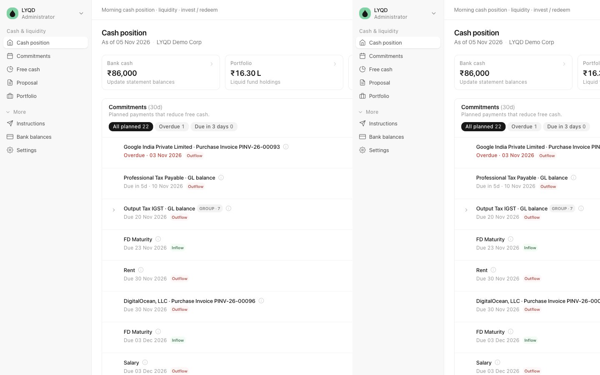
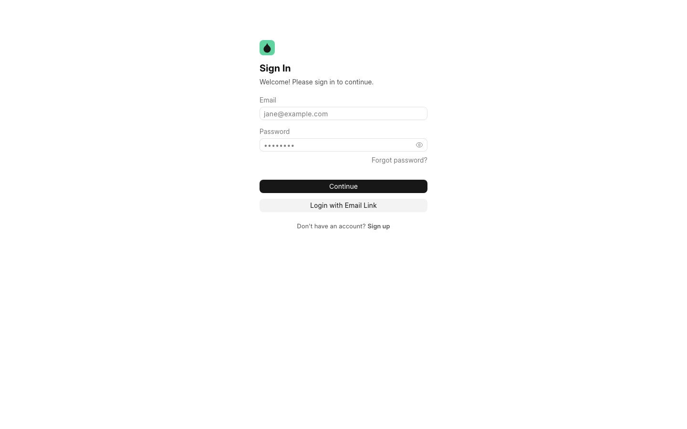
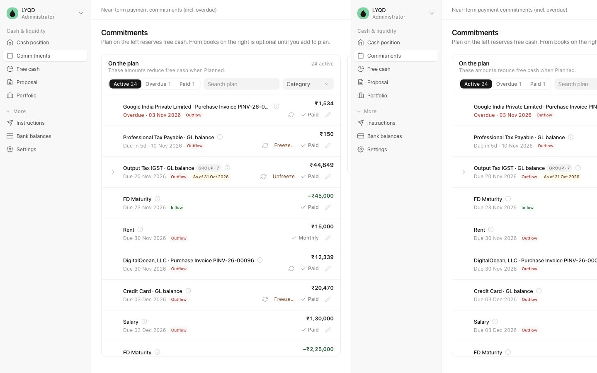
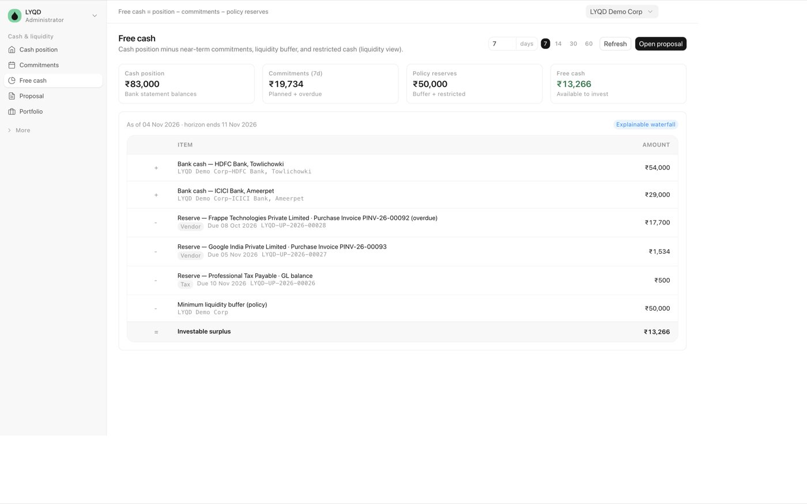
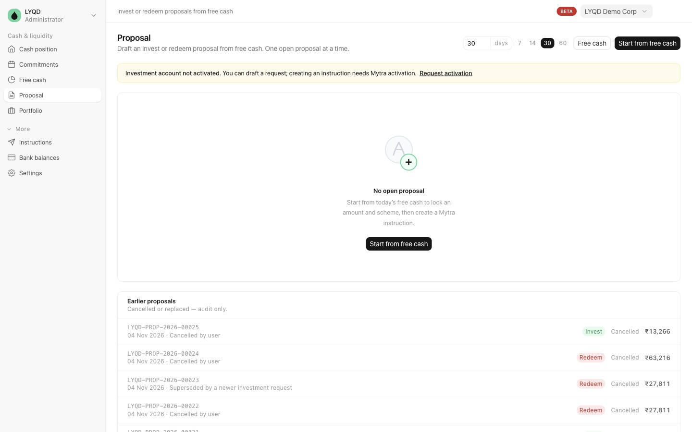
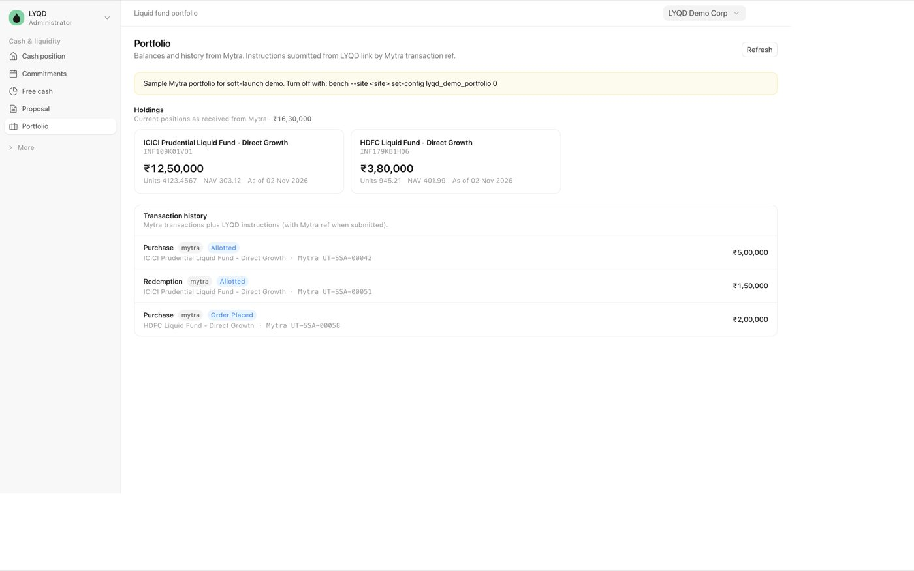
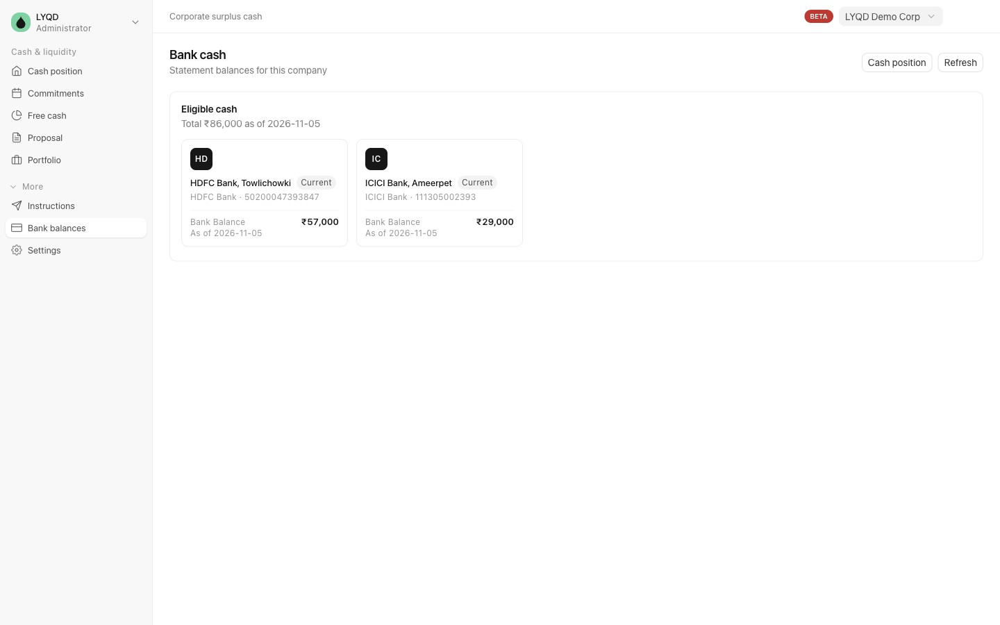
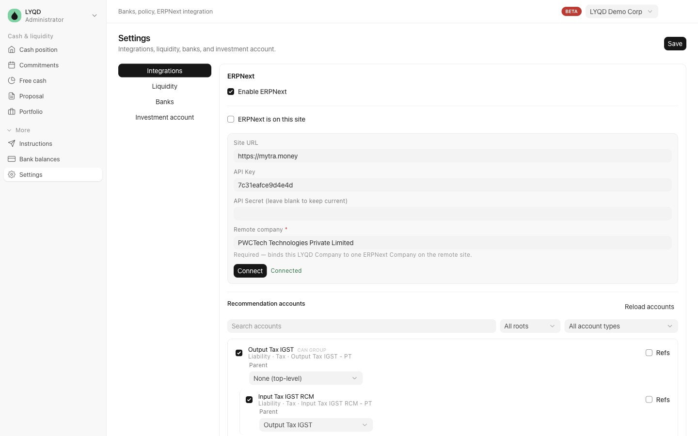

<div align="center" markdown="1">


# LYQD

**Know what cash you can invest — and when you’ll need it.**

[](license.txt)

[Try it](https://lyqd.mytra.money) · [Product page](https://mytra.money/lyqd) · [Getting started](#getting-started)

</div>



LYQD helps finance teams see bank cash, upcoming payments, and free cash in one place — then create an **Invest** or **Redeem** proposal when they’re ready.

It is built for companies that collect money before payroll, vendors, and taxes are due, and want a clear answer to: *“How much can we park in a liquid fund until the next payment?”*

---

## Getting started



1. Open [lyqd.mytra.money](https://lyqd.mytra.money) and sign in (or create an account).
2. Create your **company** (name is enough to start).
3. Add or select **bank accounts**, then enter today’s **statement balances**.
4. Add **upcoming payments** (or connect books later — optional).
5. Check **Free cash**, then create an **Invest** or **Redeem** proposal when it makes sense.

You can install LYQD on your phone with **Add to Home Screen** for a simple app-like experience.

---

## The daily flow

```
Cash position  →  Commitments  →  Free cash  →  Proposal  →  Portfolio
```

### Cash position

Your morning view: bank cash, portfolio, commitments in the next few days, and free cash (or shortfall).


Use the day picker (7 / 14 / 30 / 60 days) to change how far ahead you look.

### Commitments

The payment plan that reserves cash — salaries, vendors, taxes, rent, and anything else you expect to pay.



You can:

- **Add a payment** yourself (amount, due date, category)
- Mark payments **Paid** when done
- Set a payment to **repeat** (for example monthly rent)
- Optionally pull **suggestions from your books** (ERPNext) and add them to the plan

Related payments (for example tax groups) can appear nested so the plan stays readable.

### Free cash

A simple explanation of what is left after banks, commitments, and your safety buffer.



In plain words:

> **Free cash = bank balances − planned payments − liquidity buffer − restricted cash**

If free cash is negative, LYQD shows a **shortfall** — useful when you may need to redeem investments before a due date.

### Proposal (Invest / Redeem)

When free cash looks good, create an **Invest** proposal.  
When the horizon shows a shortfall, create a **Redeem** proposal (limited by what you hold).



Only one open proposal is kept at a time. Review it, then send it forward once your investment account is activated.

### Portfolio

See holdings and recent investment activity in one place.



### Bank cash

Update statement balances for your bank accounts. These balances always live in LYQD (they are not copied from remote books).



---

## Settings (company setup)

Open **Settings** from the menu to configure your company.



| Section | What you set |
|---------|----------------|
| **Integrations** | Optional link to ERPNext (this site or another site) for payment suggestions |
| **Liquidity** | Safety buffer, restricted cash, and default forecast days |
| **Banks** | Which bank accounts count toward free cash |
| **Investment account** | Request activation (handled by Mytra) |

You can manage more than one company. Switch companies from the top of the app.

### Optional: connect books

Books are optional. Three modes:

- **Manual** — enter balances and payments in LYQD only  
- **This site** — use ERPNext on the same site for suggestions  
- **Other site** — connect a remote ERPNext with URL + API key  

Bank **balances** are always updated in LYQD, even when account names are mirrored from books.

---

## Tips for everyday use

- Start every morning on **Cash position**, then open **Commitments** if something looks off.
- Keep the **liquidity buffer** realistic — free cash is only useful if the buffer matches how you operate.
- Prefer **due dates** on commitments so the horizon view stays honest.
- If suggestions from books look wrong, fix the account list under **Settings → Integrations**, then retry.
- Soft launch portfolio may show **sample** holdings until live investment connectivity is fully on for your company.

---

## Roles (who can do what)

| Role | Typical use |
|------|-------------|
| **LYQD User** | Day-to-day: commitments, free cash, view proposals and portfolio |
| **LYQD Manager** | Company settings, banks, confirm proposals (default on signup) |
| **System Manager** | Full access including Desk (for administrators) |

Day-to-day work happens in the LYQD app (`/lyqd`), not in Desk.

---

## Why liquid funds?

Idle money in a current account often earns little between known payment dates. LYQD is built around **short-term surplus** — cash you may need again for payroll, taxes, or vendors within days or weeks.

Human approval always comes before investment instructions. Mutual fund investments are subject to market risks; read all scheme-related documents carefully.

---

## Install (for admins)

On a Frappe bench (ERPNext optional):

```bash
cd frappe-bench
bench get-app https://github.com/mytra-money/lyqd.git
bench --site <site> install-app lyqd
bench --site <site> migrate
```

Build the app UI after install (or after frontend changes):

```bash
cd apps/lyqd/frontend && yarn && yarn build
bench --site <site> clear-cache
```

Optional demo data:

```bash
bench --site <site> execute lyqd.setup.seed.seed_demo
```

---

## About Mytra

LYQD is built by [Mytra](https://mytra.money) for corporate liquidity.

- Soft launch: [lyqd.mytra.money](https://lyqd.mytra.money)
- Product: [mytra.money/lyqd](https://mytra.money/lyqd)

---

<div align="center">

Make idle cash work smarter.

</div>
