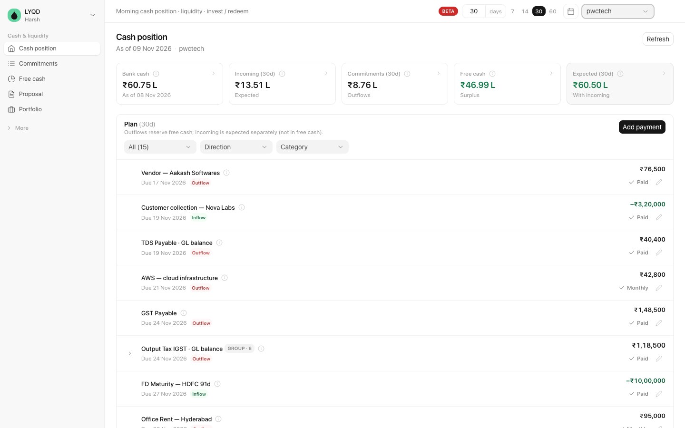
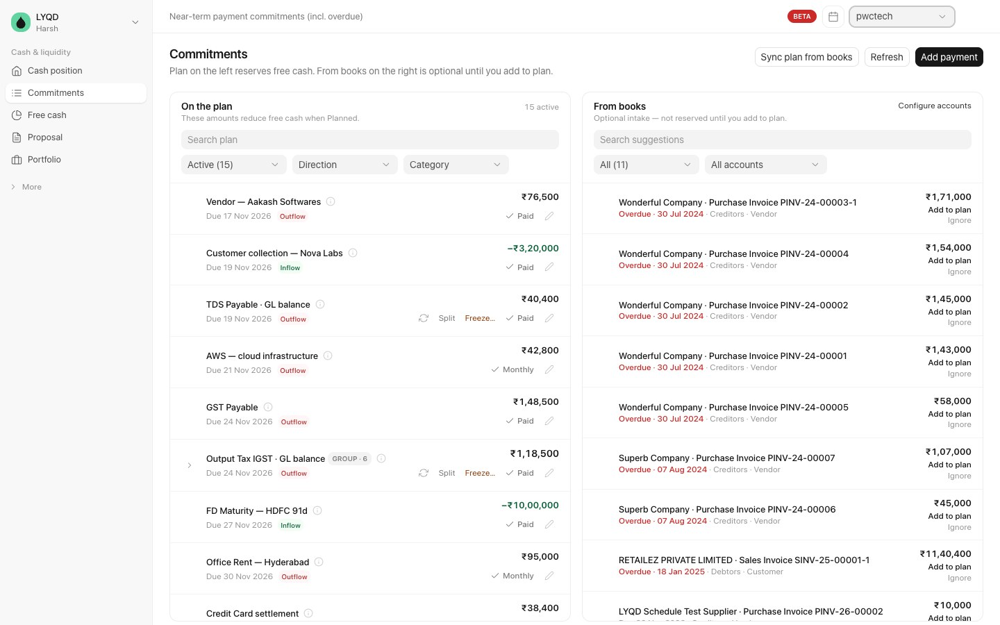
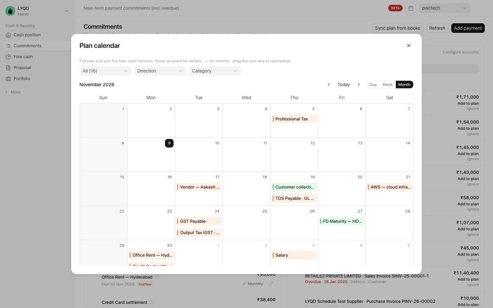
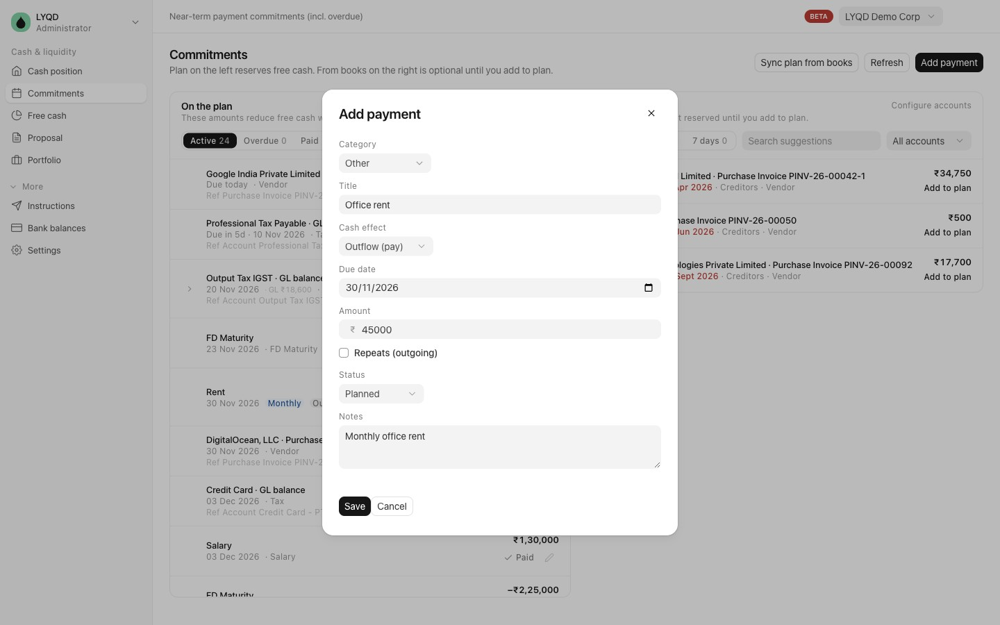
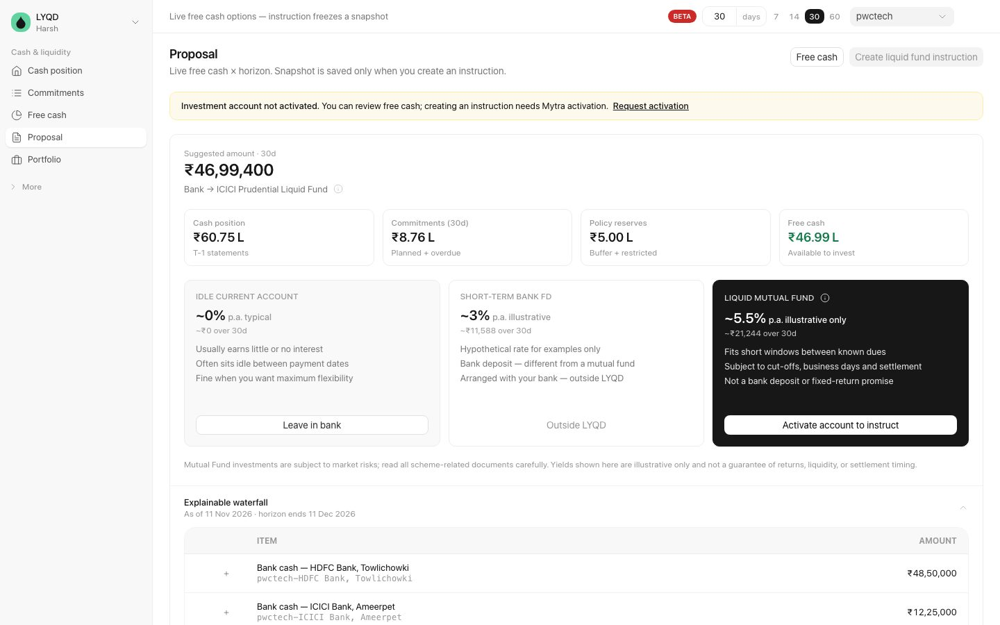

<div align="center" markdown="1">


# LYQD

**Know what cash you can invest — and when you’ll need it.**

[](license.txt)

[Try it](https://lyqd.mytra.money) · [Product page](https://mytra.money/lyqd) · [Getting started](#getting-started)

</div>




LYQD helps finance teams see bank cash, upcoming payments, and free cash in one place — then create an **Invest** or **Redeem** instruction when they’re ready.

It is built for companies that collect money before payroll, vendors, and taxes are due, and want a clear answer to: *“How much free cash does the business have (to park in a liquid fund) until the next payment?”*

---

## Getting started


1. Open [lyqd.mytra.money](https://lyqd.mytra.money) and sign in (or create an account). You can install LYQD on your own bench as well.
2. Create your **company** (name is enough to start). You can also **Connect your ERPNext Site** on LYQD to get recommendations.
3. Add or select **bank accounts**, then enter today’s **statement balances**.
4. Add **upcoming payments** (or connect books later — optional).
5. Check **Free cash**, then open **Proposal** and create an **Invest** or **Redeem** instruction when it makes sense.

You can install LYQD on your phone with **Add to Home Screen** for a simple app-like experience.

---

## The daily flow

```
Cash position  →  Commitments  →  Free cash  →  Proposal  →  Portfolio
```

### Cash position

Your morning view: bank cash, portfolio, commitments in the next few days, and free cash (or shortfall).


Use the day picker (7 / 14 / 30 / 60 days) to change how far ahead you look.

### Commitments

The payment plan that reserves cash — salaries, vendors, taxes, rent, and anything else you expect to pay.



You can:

- **Add a payment** yourself (amount, due date, category)
- Mark payments **Paid** when done
- Set a payment to **repeat** (for example monthly rent)
- Open the **Plan calendar** from the header on Cash position or Commitments (hover an event for details; drag the next due to reschedule)
- Related payments (for example tax groups) can appear nested so the plan stays readable
- With books connected: review **From books** suggestions, **Add to plan**, or **Ignore** (see [ERPNext integration](#erpnext-integration) below)






### Free cash

A simple explanation of what is left after banks, commitments, and your safety buffer.


In plain words:

> **Free cash = bank balances − planned payments − liquidity buffer − restricted cash**

If free cash is negative, LYQD shows a **shortfall** — useful when you may need to redeem investments before a due date.

### Proposal (Invest / Redeem)

Proposal is a **live** view of free cash for the selected horizon — suggested amount, the four building blocks (cash position, commitments, policy reserves, free cash), and short-term options (idle current account, short bank FD, liquid mutual fund). Illustrative horizon returns are shown for comparison only.

When you create an instruction, LYQD freezes a snapshot of that free-cash math. Until then, numbers stay live as banks, the plan, or the horizon change.



- **Invest** when free cash is positive for the horizon
- **Redeem** when the horizon shows a shortfall (capped by liquid holdings)
- Only one open instruction at a time — finish or cancel it on **Instructions** before creating another
- Creating an instruction needs a Mytra-activated investment account (AMFI Registered Mutual Fund Distributor)

Human approval always comes before investment instructions. Mutual fund investments are subject to market risks; read all scheme-related documents carefully.

### Portfolio

See holdings and recent investment activity in one place.


### Bank cash

Update statement balances for your bank accounts. Free cash always uses **LYQD** statement balances (typically as of yesterday). When books are connected, LYQD can **suggest** the latest ERPNext Bank Account Balance — you apply it locally; nothing is written back to ERPNext.


---

## Settings (company setup)

Open **Settings** from the menu to configure your company.

| Section | What you set |
|---------|----------------|
| **Integrations** | Optional link to ERPNext (this site or another site) for payment suggestions and bank account names |
| **Liquidity** | Safety buffer, restricted cash, and default forecast days |
| **Banks** | Which bank accounts count toward free cash |
| **Investment account** | Request activation (handled by Mytra) |

You can manage more than one company. Switch companies from the top of the app.


---

## ERPNext integration

Books are **optional**. Free cash still works with manual bank balances and commitments. Connecting ERPNext adds suggestions and sync — it does not replace LYQD as the system of record for statement balances or the payment plan.

### Connection modes

| Mode | What it does |
|------|----------------|
| **Manual** | Enter balances and payments in LYQD only |
| **This site** | Use ERPNext on the same Frappe site for suggestions |
| **Other site** | Connect a remote ERPNext with URL + API key / secret |

On Other site (and when settings save/probe succeeds), company **Bank Account** masters can be **mirrored** into LYQD. Statement balances stay in LYQD.

### What LYQD reads from books

| Source | How it shows up |
|--------|-----------------|
| **Purchase Invoice** / **Sales Invoice** | Open outstanding (nets payment entries and similar clearances) with due dates where available |
| **Accounts** (refs on/off) | Net GL balances — e.g. GST / TDS / payroll payable style grains; nested groups when parent accounts are configured |
| **Bank Account** masters | Names linked on LYQD Bank Account (`books_bank_account`) |
| **Bank Account Balance** | Optional **suggestion** on Bank cash (apply locally) |

Payment Entry and Journal Entry are not listed as separate suggestions — they reduce invoice / GL outstanding instead.

### Plan actions (Commitments)

Once suggestions appear under **From books**:

- **Add to plan** — creates a Planned upcoming payment with a link back to the ERPNext document
- **Ignore** — stores the row as **Ignored** so it leaves suggestions and does not reserve free cash (review under status *Ignored*)
- **Sync plan from books** / per-row **Refresh** — updates amounts, marks cleared vouchers **Paid**, cancels missing/cancelled sources
- **Freeze** — pin an Account-grain amount to GL as of a chosen date (GST / TDS style)
- **Split / Re-split** — break a books-linked amount into a dated schedule (e.g. loan / FD ladders); refresh compares live books to the schedule and can prompt Adjust split
- Nested tax / liability groups stay readable; **group net** is used for nest totals and split basis

Only **Planned** outflows in the forecast horizon reserve free cash. Inflows are shown as expected incoming (with optional probability) and do **not** increase investable free cash.

### What stays manual

- Daily / T-1 **statement balances** in LYQD (remote balance is a tip, not auto-applied)
- Choosing which suggestions to **Add** or **Ignore**
- **Sync** when books change (morning cash position does not sync the plan by itself)
- Recurring rows such as rent or payroll when not driven from an Account grain
- Invest / Redeem **instructions** (Mytra handoff is soft-launch gated)

---

## Tips for everyday use

- Start every morning on **Cash position**, then open **Commitments** if something looks off.
- Use the header **calendar** for the full plan across months (repeating payments show each due).
- Keep the **liquidity buffer** realistic — free cash is only useful if the buffer matches how you operate.
- Prefer **due dates** on commitments so the horizon view stays honest.
- After books change (payments, cancellations), use **Sync plan from books** so free cash stays honest — custom titles you set on plan rows stay put.
- If suggestions look wrong, fix the account list under **Settings → Integrations**, then retry.
- Soft launch portfolio may show **sample** holdings until live investment connectivity is fully on for your company.

---

## Roles (who can do what)

| Role | Typical use |
|------|-------------|
| **LYQD User** | Day-to-day: commitments, free cash, view proposal and portfolio |
| **LYQD Manager** | Company settings, banks, confirm instructions (default on signup) |
| **System Manager** | Full access including Desk (for administrators) |

Day-to-day work happens in the LYQD app (`/lyqd`), not in Desk.


---

## Install (for admins)

On a Frappe bench (ERPNext optional):

```bash
cd frappe-bench
bench get-app https://github.com/mytra-money/lyqd.git
bench --site <site> install-app lyqd
bench --site <site> migrate
```

Build the app UI after install (or after frontend changes):

```bash
cd apps/lyqd/frontend && yarn && yarn build
bench --site <site> clear-cache
```

Optional demo data:

```bash
bench --site <site> execute lyqd.setup.seed.seed_demo
```

---

## About Mytra

LYQD is built by [Mytra](https://mytra.money) for corporate liquidity.

- Soft launch: [lyqd.mytra.money](https://lyqd.mytra.money)
- Product: [mytra.money/lyqd](https://mytra.money/lyqd)

---

<div align="center">

Make idle cash work smarter.

</div>
